# Torque-Vectoring

> Nonlinear Four-Wheel Vehicle Dynamics, Spatial Multi-$\mu$ Contact Mechanics, and Optimal Yaw-Moment Control

[](pyproject.toml)
[](docs/architecture.md)
[](docs/limitations.md)

`torquevector` is a scientific Python simulation and verification framework for **11-state planar four-wheel vehicle dynamics**, **Pacejka combined-slip tyre mechanics**, **heterogeneous road friction** $\mu_{\text{road}}(X, Y)$, **multi-rate wheel-slip control (`ABS`/`ASR` at 200 Hz)**, and **direct yaw-moment control (`OFF`, `P`, `LQR`, `LTV-MPC`, `NMPC`)** with **friction-aware BVLS torque allocation** (25 Hz).

> [!IMPORTANT]
> **Validation Boundary (`REQUIRED_REAL_DATA`)**: All vehicle parameters ([`generic_passenger_car.yaml`](configs/vehicles/generic_passenger_car.yaml)) are synthetic assumptions and the Pacejka tyre ([`pacejka_fitted_synthetic.yaml`](configs/tyres/pacejka_fitted_synthetic.yaml)) is calibrated on synthetic brush-model data ([`data/synthetic/`](data/synthetic/)). Experimental vehicle validation (**Gate Q10**) is **`REQUIRED_REAL_DATA`**. See [`docs/limitations.md`](docs/limitations.md).

---

## Visual Highlights (`assets/`)

| 2D Vehicle Comparison (`double_lane_change` at $17\text{ m/s}$) | Multi-$\mu$ Road Friction & Wheel Forces (`mixed_mu_lane_change`) |
| :---: | :---: |
| 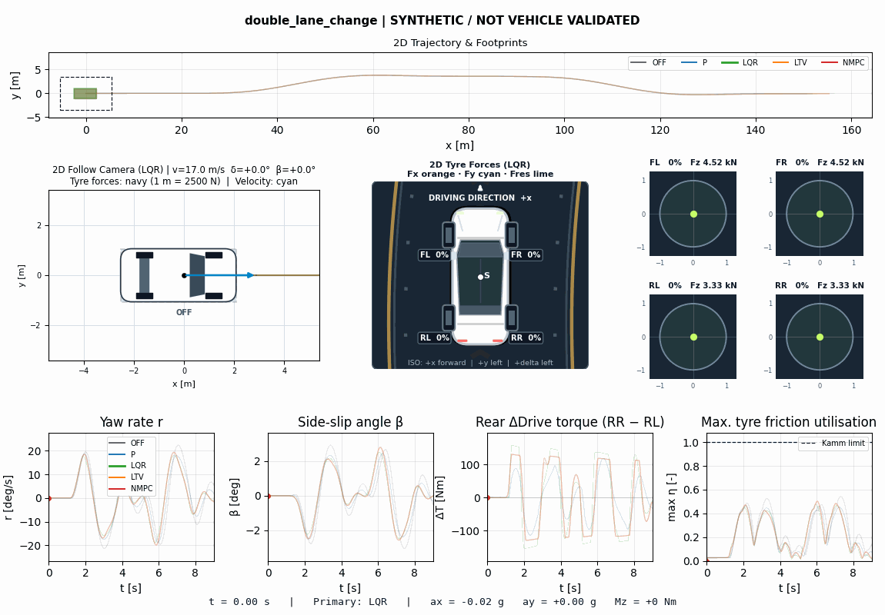 | 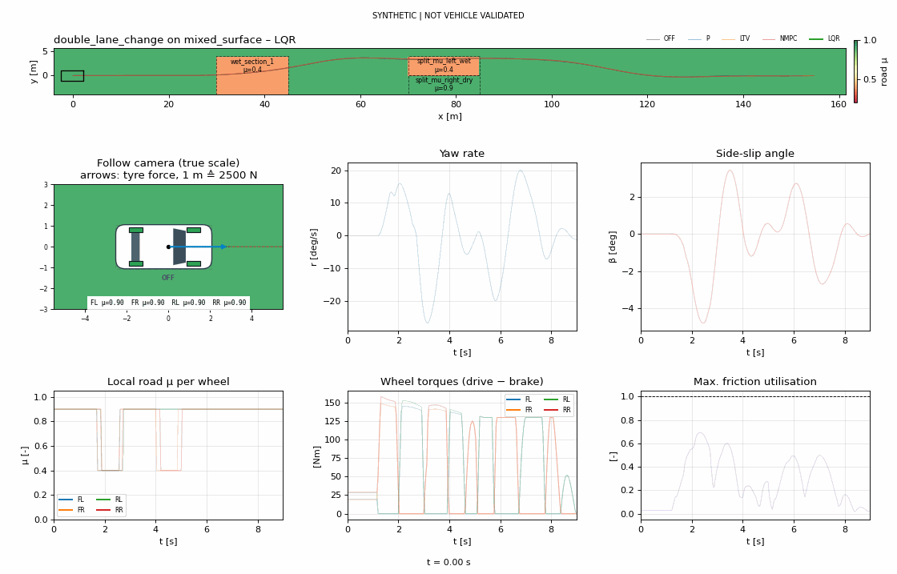 |
| **2D Circle Track (`circle_track`, $R = 90\text{ m}$, $15\text{ m/s}$)** | **Split-$\mu$ Emergency Braking + 200 Hz ABS ($\mu_L = 0.4, \mu_R = 0.9$)** |
| 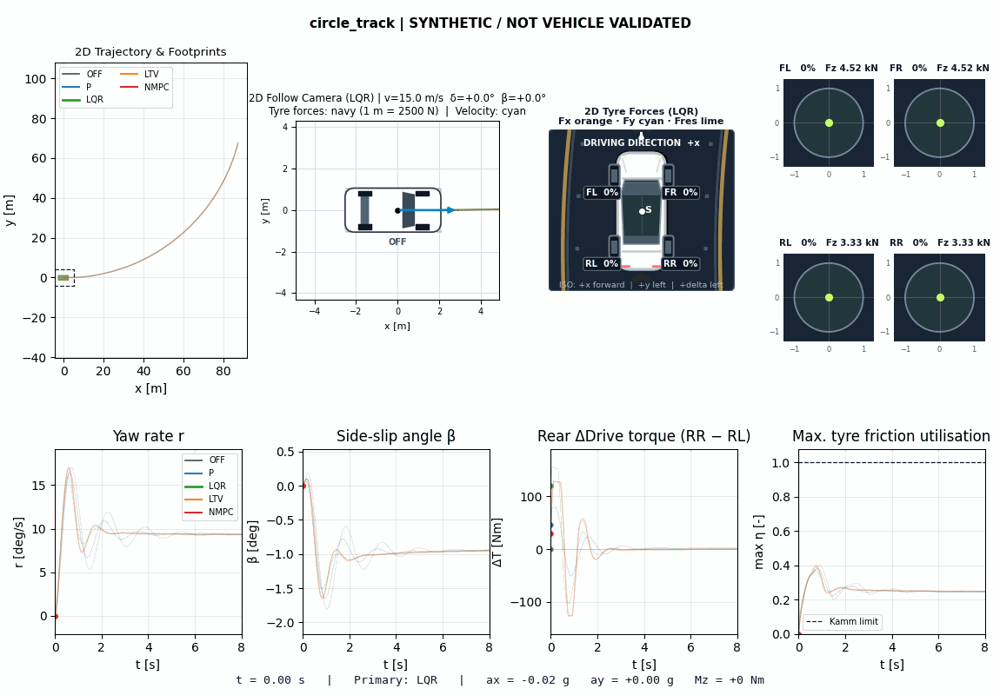 | 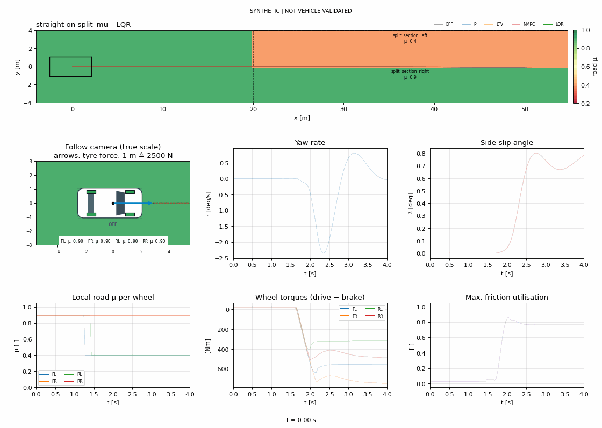 |

| Controller KPI Comparison (`double_lane_change`) | BVLS Yaw-Moment & Wheel Torque Allocation |
| :---: | :---: |
| 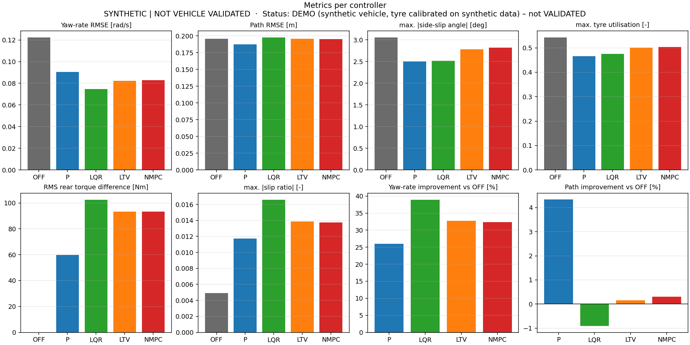 | 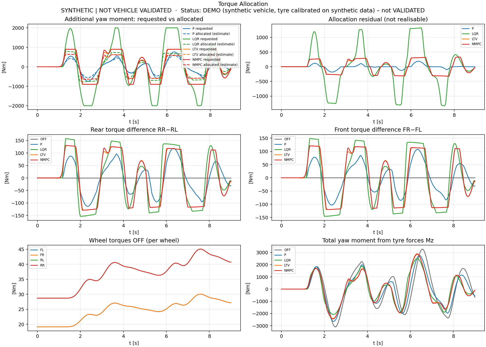 |
| **Normalized Kamm Friction Circles (`FL/FR/RL/RR`)** | **Spatial Friction Map (`mixed_mu_lane_change`)** |
| 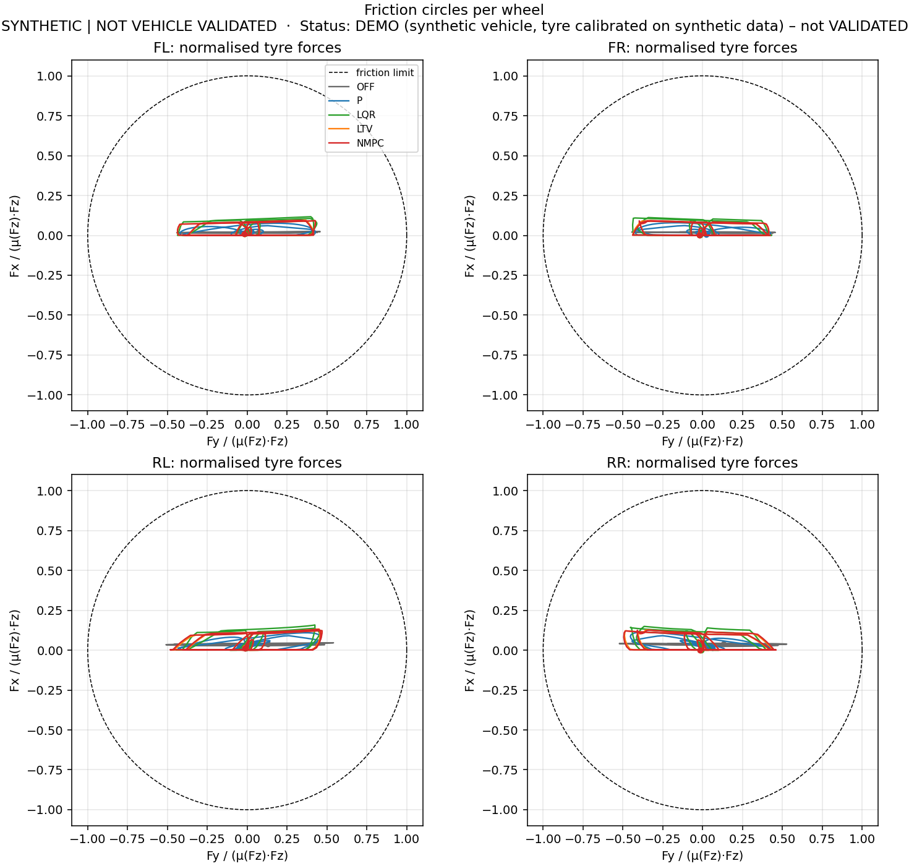 | 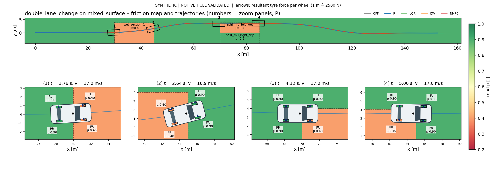 |
| **ISO 4138 Self-Steering (`OFF` $\to$ Oversteer Spinout)** | **ISO 4138 Self-Steering (`LQR` $\to$ Stabilized Understeer)** |
| 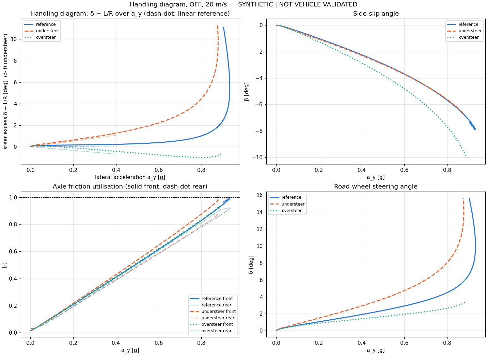 | 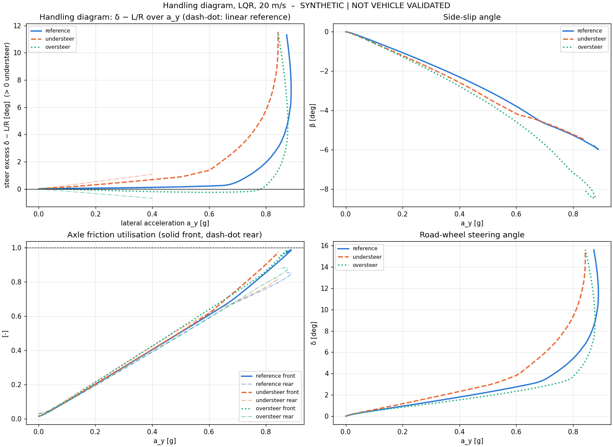 |
| **$(\beta, r)$ Phase-Plane Stability ($25\text{ m/s}$, $0.5^\circ$)** | **Combined-Slip Pacejka Characteristics** |
| 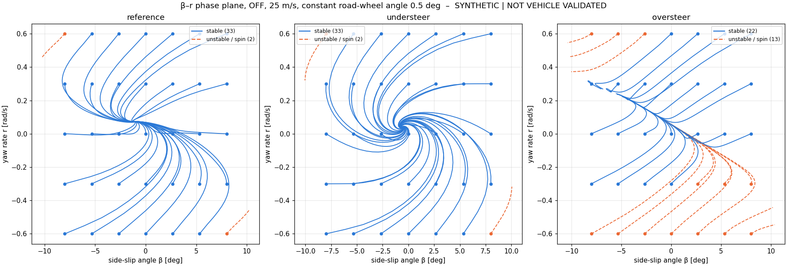 | 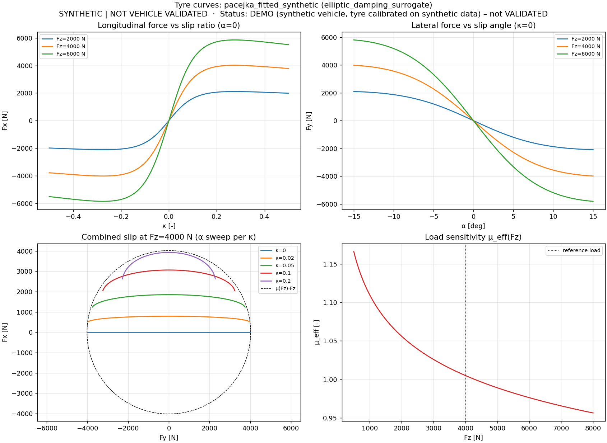 |

*(Additional diagnostic plot: [`assets/gg_diagram.png`](assets/gg_diagram.png).)*

---

## Physics & Hierarchical Control Architecture

- **11-State Plant ([`src/torquevector/physics/`](src/torquevector/physics/))**: Planar Newton–Euler dynamics $(X, Y, \psi, v_x, v_y, r)$, four wheel spin speeds $(\omega_{\text{FL}}, \omega_{\text{FR}}, \omega_{\text{RL}}, \omega_{\text{RR}})$, and first-order steering actuator $\delta_{\text{act}}$ ($\tau_\delta = 45\text{ ms}$), integrated via RK45 with exact road-boundary event restarts and simultaneous Powell-hybrid load transfer $\sum F_{z,i} = mg$.
- **Tyre & Fail-Closed Domain**: Load-degressive Pacejka Magic Formula, elliptic opposing-slip damping, strict Kamm friction circle $\sqrt{F_x^2 + F_y^2} \le D_i$, and immediate `OutsideEnvelopeError` termination on wheel lift, spin-out ($|\kappa| > 0.5$), or low-speed singularities ($u_w < 3.0\text{ m/s}$).
- **Control & Allocation ([`src/torquevector/control/`](src/torquevector/control/))**:

| Layer | Formulation | Rate / Solver | Key Role |
|---|---|---|---|
| **Yaw Reference** | $r_{\text{ref}} = \operatorname{clip}\!\left(\frac{v_x\tan\delta_{\text{act}}}{L},\,\pm\frac{\mu_{\text{est}}g}{v_x}\right)$ + LP filter ($\tau=90\text{ ms}$) | $25\text{ Hz}$ | Causal steering demand |
| **`P` / `LQR`** | Proportional + sideslip damping / Continuous CARE gain schedule | $25\text{ Hz}$ | Feedback yaw moment ($|M_z|\le 2000\text{ Nm}$) |
| **`LTV-MPC` / `NMPC`** | Expm ZOH linearized MPC (SLSQP) / CasADi $\tanh$-tyre NMPC (IPOPT) | $25\text{ Hz}$ | Predictive yaw + $\beta$ constraints ($|M_z|\le 900\text{ Nm}$) |
| **BVLS Allocator** | $\min_{\Delta T}\|W(A\,\Delta T - b)\|_2^2$ s.t. $R_{\text{eff}}\rho\mu_{\text{est},i}\widehat{F}_{z,i}$ & actuator limits | $25\text{ Hz}$ | Friction-aware wheel torques |
| **Inner Slip Loop** | Incremental velocity-form PI torque reduction $r_i \in [0, 0.95]$ | $200\text{ Hz}$ | Individual-wheel `ABS` / `ASR` |

---

## Reproduced Benchmark Summary

Results reproduced cleanly across uniform scenario and specification folders under `results/` (see full details in [`docs/validation/torque-vectoring.md`](docs/validation/torque-vectoring.md) and [`docs/validation/quality-audit.md`](docs/validation/quality-audit.md)):

| Scenario / Specification | Metric | `OFF` | `P` | `LQR` | `LTV-MPC` | `NMPC` |
|---|---|---:|---:|---:|---:|---:|
| **`circle_track`** ($15\text{ m/s}$, $R=90\text{ m}$) | Yaw $\operatorname{RMSE}_r$ (vs. `OFF`) | $0.0432$ | $+15.4\,\%$ | **$+27.3\,\%$** | $+19.6\,\%$ | $+18.9\,\%$ |
| **`circle_track_19`** ($19\text{ m/s}$, $R=90\text{ m}$) | Yaw $\operatorname{RMSE}_r$ improvement | — | $+26.3\,\%$ | $+39.0\,\%$ | **$+40.5\,\%$** | $+39.6\,\%$ |
| **`double_lane_change`** ($17\text{ m/s}$) | Yaw $\operatorname{RMSE}_r$ (vs. `OFF`) | $0.1223$ | $+26.0\,\%$ | **$+38.9\,\%$** | $+32.8\,\%$ | $+32.4\,\%$ |
| **`mixed_mu_lane_change`** ($\mu \in [0.4, 0.9]$) | Yaw / Path improvement | $0.2136$ | $+36.1 / +6.5\,\%$ | **$+47.9\,\%$** / $+6.5\,\%$ | $+33.1 / +6.5\,\%$ | $+34.1 / \mathbf{+6.9\,\%}$ |
| **`straight_split_mu_braking_abs`** ($15\text{ m/s}$) | Yaw / Path improvement | $0.0277$ | $+20.6 / +14.3\,\%$ | $+51.3 / +37.4\,\%$ | **$+55.0\,\%$** / $+46.5\,\%$ | **$+55.0 / +46.5\,\%$** |
| **`double_lane_change_wet_mu04`** ($\mu = 0.4$) | Closed-loop status | `FAIL_CLOSED` | `INVALID_ENVELOPE` | **`PASS`** | `INVALID_ENVELOPE` | **`PASS`** |
| **ISO 4138 Oversteer Stabilization** | Limit @ $15/20/25\text{ m/s}$ | `loss of stability` | — | **`limit understeer`** | — | — |

---

## Quick Start & Reproducing All Results

```bash
# 1. Create virtual environment and install pinned dependencies
python3 -m venv .venv && source .venv/bin/activate
python -m pip install -e '.[dev,nmpc,viz]' -c requirements.txt

# 2. Run a single scenario comparison into a named folder + render 2D animation
torquevector compare --scenario double_lane_change --controllers off p lqr ltv nmpc \
    --results-dir results --run-name double_lane_change --report
torquevector render --result results/double_lane_change --format gif

# 3. Reproduce every scenario/specification folder in results/ and refresh assets/
python scripts/reproduce_results.py

# 4. Run full verification suite (zero skips allowed)
python -m unittest discover -s tests -v
```

Every output directory in `results/` follows uniform scenario or specification naming (`circle_track/`, `double_lane_change/`, `double_lane_change_wet_mu04/`, `step_steer/`, `sine_steer/`, `mixed_mu_lane_change/`, `straight_multi_mu/`, `straight_split_mu_braking/`, `straight_split_mu_braking_abs/`, `straight_split_mu_acceleration/`, `handling_iso4138/`, `tyre_pacejka_fitted_synthetic/`, `scenario_matrix_benchmark/`).

---

## Documentation

| Document | Topic |
|---|---|
| [`docs/README.md`](docs/README.md) | Complete documentation index |
| [`docs/model/specification.md`](docs/model/specification.md) | 11-state plant, load transfer solver, Pacejka combined-slip |
| [`docs/model/handling.md`](docs/model/handling.md) & [`road-friction.md`](docs/model/road-friction.md) | ISO 4138 handling theory & spatial $\mu_{\text{road}}(X, Y)$ |
| [`docs/control/specification.md`](docs/control/specification.md) & [`slip-control.md`](docs/control/slip-control.md) | `P`, `LQR`, `LTV-MPC`, `NMPC`, BVLS allocator & `ABS`/`ASR` |
| [`docs/validation/torque-vectoring.md`](docs/validation/torque-vectoring.md) & [`quality-audit.md`](docs/validation/quality-audit.md) | Gate Q11 benchmarks & 13-gate verification audit |
| [`docs/getting-started.md`](docs/getting-started.md) & [`user-guide.md`](docs/user-guide.md) | CLI usage, configuration overrides & offline telemetry rendering |
| [`docs/limitations.md`](docs/limitations.md) & [`CHANGELOG.md`](CHANGELOG.md) | Scientific limitations, release history |
