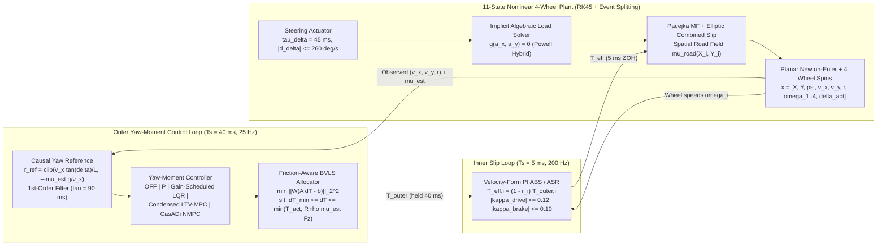

Torque-Vectoring


> Nonlinear Four-Wheel Vehicle Dynamics, Multi-$\mu$ Contact Mechanics, and Optimal Torque-Vectoring Control

[](pyproject.toml)
[](docs/architecture.md)
[-informational.svg)](docs/validation/quality-audit.md)
[](docs/limitations.md)

`torquevector` is a self-contained scientific Python simulation and verification framework for **planar four-wheel vehicle dynamics**, **combined-slip Pacejka tyre mechanics**, **heterogeneous spatial road friction $\mu_{\text{road}}(X, Y)$**, **multi-rate wheel-slip control (ABS/ASR)**, and **hierarchical direct yaw-moment control (`OFF`, `P`, `LQR`, `LTV-MPC`, `NMPC`)** with **friction-aware Bounded Variable Least Squares (BVLS) wheel-torque allocation**.

> [!IMPORTANT]
> **Epistemic Status & Experimental Validation Boundary (`SYNTHETIC / NOT VEHICLE VALIDATED`)**:
> All vehicle mass, inertia, and geometric parameters in [`configs/vehicles/generic_passenger_car.yaml`](configs/vehicles/generic_passenger_car.yaml) are synthetic engineering assumptions, and the tyre model in [`configs/tyres/pacejka_fitted_synthetic.yaml`](configs/tyres/pacejka_fitted_synthetic.yaml) is identified against a synthetic two-dimensional isotropic brush-model dataset ([`data/synthetic/synthetic_brush_measurements.csv`](data/synthetic/synthetic_brush_measurements.csv), $N = 2{,}520$). No physical flat-trac tyre bench or instrumented test-track measurements are included. Accordingly, experimental vehicle validation (**Gate Q10**) is explicitly declared **`REQUIRED_REAL_DATA`**, and synthetic-data calibration checks (`Q02`, `Q03.2`) are conservatively capped at $1/2$ points in the automated quality audit ([`docs/validation/quality-audit.md`](docs/validation/quality-audit.md)).

---

## 1 Visual Overview

| Mixed-$\mu$ Double Lane Change (`LQR` on $\mu \in [0.35, 0.95]$) | Controller Trajectory & Force Comparison (`OFF` vs. `P`, `LQR`, `LTV`, `NMPC`) |
| :---: | :---: |
|  |  |
| **Split-$\mu$ Emergency Braking with Inner-Loop ABS ($\mu_L = 0.25, \mu_R = 0.95$)** | **ISO 4138 Self-Steering Handling Diagram ($\Delta\delta$ vs. $a_y/g$)** |
|  |  |

---

## 2 Mathematical and Physical Architecture

The simulator couples an **11-state continuous-time nonlinear vehicle plant** with a **two-level multi-rate zero-order-hold (ZOH) control hierarchy** (full derivations in [`docs/model/specification.md`](docs/model/specification.md) and [`docs/control/specification.md`](docs/control/specification.md)):



### 2.1 Governing Plant Equations (`src/torquevector/physics/`)
- **State Vector ($\mathbf{x} \in \mathbb{R}^{11}$)**: Inertial pose $(X, Y, \psi)$, body-frame velocities $(v_x, v_y)$, yaw rate $r = \dot{\psi}$, four dynamic wheel spin speeds $(\omega_{\text{FL}}, \omega_{\text{FR}}, \omega_{\text{RL}}, \omega_{\text{RR}})$, and first-order steering actuator angle $\delta_{\text{act}}$.
- **Planar Newton–Euler Balance & Wheel Rotational Dynamics**:
  $$m(\dot{v}_x - r\,v_y) = \sum_{i \in \mathcal{W}} F_{x,\text{body},i} - F_{\text{aero}}(v_x) - F_{\text{roll}}(v_x), \qquad m(\dot{v}_y + r\,v_x) = \sum_{i \in \mathcal{W}} F_{y,\text{body},i},$$
  $$I_z\,\dot{r} = \sum_{i \in \mathcal{W}} \big(x_i F_{y,\text{body},i} - y_i F_{x,\text{body},i}\big), \qquad J_w\,\dot{\omega}_i = T_{\text{drive},i} - T_{\text{brake},i}\tanh(2\omega_i) - R_{\text{eff}}\,F_{x,w,i}.$$
- **Algebraic-Loop-Free Quasi-Static Load Transfer**: At every Runge–Kutta stage, normal loads $F_{z,i}(a_x, a_y)$ and resultant tyre forces $\mathbf{F}_w(F_{z,i})$ are solved simultaneously via Powell's hybrid root method (`scipy.optimize.root(method='hybr', tol=1e-11)`), eliminating numerical one-step delay and strictly conserving $\sum_{i=1}^4 F_{z,i} = m g$.
- **Combined-Slip Tyre Law & Kamm Circle**: Pure longitudinal and lateral forces follow a load-degressive Pacejka Magic Formula ($D_i = \mu_{\text{road},i}(F_{z,i}/F_{z,0})^{k_{\text{load}}} F_{z,i}$, $k_{\text{load}} = -0.0716$), coupled via opposing-slip Lorentzian damping $\tilde{F}_{x,i} = F_{x,0}/\sqrt{1+(\alpha_i/\alpha_s)^2}$, $\tilde{F}_{y,i} = F_{y,0}/\sqrt{1+(\kappa_i/\kappa_s)^2}$ and radially projected onto the friction circle $\sqrt{F_{x,w,i}^2 + F_{y,w,i}^2} \le D_i$.
- **Spatial Road Friction $\mu_{\text{road}}(X_i, Y_i)$ with Discontinuity Event Splitting**: Evaluates surface friction at each individual wheel contact patch with $C^2$ quintic smoothstep transitions or exact `solve_ivp` root-finding event restarts at sharp surface boundaries ([`docs/model/road-friction.md`](docs/model/road-friction.md)).
- **Fail-Closed Operating Domain (`OutsideEnvelopeError`)**: Rejects low-speed singularities ($u_{w,i} < 3.0\text{ m/s}$), reverse motion ($v_x \le 0$), wheel lock/spin beyond $|\kappa_i| > 0.5$, and wheel lift ($\min_i F_{z,i} \le 0$) immediately without silent clipping or `NaN` propagation.

---

## 3 Control, Allocation, and Slip-Control Hierarchy

| Layer / Module | Method & Mathematical Formulation | Rate / Solver | Key Configuration Parameters |
|---|---|---|---|
| **Yaw Reference** ([`references.py`](src/torquevector/control/references.py)) | Causal driver-steering demand $r_{\text{raw}} = \frac{v_x\tan\delta_{\text{act}}}{L}$, clamped to $\pm\frac{\mu_{\text{est}}g}{v_x}$ and low-pass filtered ($\tau_{\text{ref}} = 0.09\text{ s}$) | $25\text{ Hz}$ ($40\text{ ms}$) | `driver.yaw_reference.source: driver_steering` |
| **`OFF` Baseline** ([`off.py`](src/torquevector/control/controllers/off.py)) | Passive reference vehicle ($M_{z,\text{cmd}} \equiv 0\text{ Nm}$) under identical steering/speed driver | $25\text{ Hz}$ | `configs/controllers/off.yaml` |
| **`P` Controller** ([`pid.py`](src/torquevector/control/controllers/pid.py)) | Proportional yaw-rate feedback + sideslip damping: $M_z = K_p(r_{\text{ref}} - r) - s_\beta(\beta)K_\beta\beta$ | $25\text{ Hz}$ | $K_p = 4400$, $K_\beta = 1450$, $\|M_z\| \le 2000\text{ Nm}$ |
| **`LQR` Controller** ([`lqr.py`](src/torquevector/control/controllers/lqr.py)) | Gain-scheduled continuous-time Algebraic Riccati Equation ($\mathbf{A}(v_x)^\top\mathbf{P} + \mathbf{P}\mathbf{A}(v_x) - \mathbf{P}\mathbf{B}R^{-1}\mathbf{B}^\top\mathbf{P} + \mathbf{Q} = \mathbf{0}$) interpolated over $v_x \in [8, 34]\text{ m/s}$ | $25\text{ Hz}$ (`solve_continuous_are`) | $\beta_{\text{scale}} = 0.05\text{ rad}$, $r_{\text{scale}} = 0.08\text{ rad/s}$, $\|M_z\| \le 2000\text{ Nm}$ |
| **`LTV-MPC`** ([`ltv_mpc.py`](src/torquevector/control/controllers/ltv_mpc.py)) | Local finite-difference tyre linearization + exact matrix-exponential ZOH discretization (`expm`), DARE terminal cost $\mathbf{P}_\infty$, soft $(\beta, r)$ constraints | $25\text{ Hz}$, $N = 6$ (`SLSQP`) | $w_u = 0.12$, $w_{\Delta u} = 0.06$, $\|M_z\| \le 900\text{ Nm}$, $\|\Delta M_z\| \le 450\text{ Nm}$ |
| **`NMPC`** ([`nmpc.py`](src/torquevector/control/controllers/nmpc.py)) | Reduced-order nonlinear single-track model with $\tanh$ axle saturation, RK4 shooting in CasADi | $25\text{ Hz}$, $N = 5$ (`IPOPT`) | $w_u = 0.12$, $w_{\Delta u} = 0.06$, $\|M_z\| \le 900\text{ Nm}$, $\|\Delta M_z\| \le 450\text{ Nm}$ |
| **Torque Allocator** ([`allocation_friction.py`](src/torquevector/control/allocation_friction.py)) | Weighted Bounded Variable Least Squares (`lsq_linear` BVLS) with quasi-static load & friction ceiling $\tilde{T}_{\max,i} = R_{\text{eff}}\rho\mu_{\text{est},i}\widehat{F}_{z,i}$ | $25\text{ Hz}$ (`BVLS`) | `mode: friction_aware`, $\rho = 0.85$, $T_{\text{act,max}} = 800\text{ Nm}$, $\Delta T_{\max} = 420\text{ Nm}$ |
| **Wheel Slip Control** ([`slip_control.py`](src/torquevector/control/slip_control.py)) | Incremental velocity-form PI controller on torque reduction factor $r_i \in [0, 0.95]$ for ABS ($\|\kappa\| \le 0.10$) and ASR ($\kappa \le 0.12$) | $200\text{ Hz}$ ($5\text{ ms}$) | $k_p = 4.5$, $k_i = 55\text{ s}^{-1}$, $\dot{r}_{\text{build}} = 18\text{ s}^{-1}$, $\dot{r}_{\text{release}} = 4\text{ s}^{-1}$ |

| Controller KPI Comparison (`double_lane_change` @ $17\text{ m/s}$) | BVLS Wheel-Torque Allocation (`double_lane_change`) |
| :---: | :---: |
|  |  |

---

## 4 Key Empirical Results & Critical Scientific Findings

### 4.1 Nominal & Robustness Torque-Vectoring Benchmark Matrix (`Gate Q11.3`)
Evaluated across the canonical Q11 nominal (`q11_nominal`) and robustness (`q11_robust`) manoeuvre sets (`torquevector q11`, [`docs/validation/torque-vectoring.md`](docs/validation/torque-vectoring.md)) using causal `driver_steering` yaw-rate reference and `friction_aware` BVLS torque allocation:

| Manoeuvre Case | Speed $v_{x,0}$ | Metric | `OFF` | `P` | `LQR` | `LTV-MPC` | `NMPC` |
|---|---:|---|---:|---:|---:|---:|---:|
| **`circle_track_15`** ($R = 90\text{ m}$, $8\text{ s}$) | $15.0\text{ m/s}$ | Yaw $\operatorname{RMSE}_r$ $[\text{rad/s}]$<br>Improvement vs. `OFF`<br>Path impr. vs. `OFF` | $0.0432$<br>—<br>— | $0.0365$<br>$+15.4\,\%$<br>$+0.0\,\%$ | $0.0314$<br>**$+27.3\,\%$**<br>$-3.1\,\%$ | $0.0347$<br>$+19.6\,\%$<br>$-3.5\,\%$ | $0.0350$<br>$+18.9\,\%$<br>$-3.3\,\%$ |
| **`circle_track_19`** ($R = 90\text{ m}$, $8\text{ s}$) | $19.0\text{ m/s}$ | Yaw $\operatorname{RMSE}_r$ $[\text{rad/s}]$<br>Improvement vs. `OFF`<br>Path impr. vs. `OFF` | $0.0673$<br>—<br>— | $0.0495$<br>**$+26.3\,\%$**<br>$-0.3\,\%$ | $0.0410$<br>**$+39.0\,\%$**<br>$-3.6\,\%$ | $0.0400$<br>**$+40.5\,\%$**<br>$-3.7\,\%$ | $0.0406$<br>**$+39.6\,\%$**<br>$-3.5\,\%$ |
| **`double_lane_change_17`** ($9\text{ s}$) | $17.0\text{ m/s}$ | Yaw $\operatorname{RMSE}_r$ $[\text{rad/s}]$<br>Improvement vs. `OFF`<br>Path impr. vs. `OFF` | $0.1223$<br>—<br>— | $0.0905$<br>**$+26.0\,\%$**<br>$+4.3\,\%$ | $0.0748$<br>**$+38.9\,\%$**<br>$-0.9\,\%$ | $0.0822$<br>**$+32.8\,\%$**<br>$+0.2\,\%$ | $0.0828$<br>**$+32.4\,\%$**<br>$+0.3\,\%$ |
| **`double_lane_change_21`** ($9\text{ s}$) | $21.0\text{ m/s}$ | Yaw $\operatorname{RMSE}_r$ $[\text{rad/s}]$<br>Improvement vs. `OFF`<br>Path impr. vs. `OFF` | $0.2416$<br>—<br>— | $0.1695$<br>**$+29.8\,\%$**<br>$-0.6\,\%$ | $0.1493$<br>**$+38.2\,\%$**<br>$-4.5\,\%$ | $0.1549$<br>**$+35.9\,\%$**<br>$-4.9\,\%$ | $0.1560$<br>**$+35.4\,\%$**<br>$-3.3\,\%$ |
| **`mixed_mu_lane_change`** ($\mu \in [0.40, 0.95]$) | $17.0\text{ m/s}$ | Yaw $\operatorname{RMSE}_r$ $[\text{rad/s}]$<br>Improvement vs. `OFF`<br>Path impr. vs. `OFF` | $0.2137$<br>—<br>— | $0.1366$<br>**$+36.1\,\%$**<br>$+6.5\,\%$ | $0.1114$<br>**$+47.9\,\%$**<br>$+6.5\,\%$ | $0.1429$<br>**$+33.1\,\%$**<br>$+6.5\,\%$ | $0.1408$<br>**$+34.1\,\%$**<br>$+6.9\,\%$ |

> [!NOTE]
> **Critical Control Finding — Why `LQR` Qualifies Across All 9 Nominal & Robustness Cases While `LTV-MPC`/`NMPC` Lead at Higher Cornering Loads**:
> - At higher lateral acceleration (`circle_track_19` at $19\text{ m/s}$) and under actuator saturation (`saturated_dlc_21`), **`LTV-MPC` ($+40.5\,\%$)** and **`NMPC` ($+39.6\,\%$)** achieve the lowest yaw-rate RMSE of all controllers, outperforming `LQR` ($+39.0\,\%$). Furthermore, on the wet double lane change (`wet_dlc_17`, $\mu = 0.40$), where `OFF` spins out (`FAIL_CLOSED`), both **`LQR`** and **`NMPC`** maintain full vehicle stability (**`PASS`**).
> - On the moderate-speed steady-state circle (`circle_track_15` at $15\text{ m/s}$), `LTV-MPC` ($+19.6\,\%$) and `NMPC` ($+18.9\,\%$) stop just $0.4\text{--}1.1$ percentage points shy of the $20\,\%$ threshold due to: (1) their tighter configured moment limit ($M_{z,\max} = 900\text{ Nm}$ vs. $2{,}000\text{ Nm}$ for `LQR`/`P`), (2) finite-horizon input magnitude regularization ($w_u = 0.12$) without integral action or steady-state understeer feedforward $M_{z,\text{ff}}$, and (3) stage-cost penalization of non-zero kinematic steady-state sideslip $\beta_{\text{ss}} \neq 0$ against $\beta_{\text{ref}} = 0$.

### 4.2 Self-Steering & Handling Limit Analysis (`torquevector handling`)
Evaluated via analytical linear single-track theory and 18-second quasi-steady ISO 4138 ramp-steer simulations ([`docs/model/handling.md`](docs/model/handling.md)):

| Vehicle Variant | Linear $K$ $[\text{deg}/g]$ | $v_{\text{char}}$ / $v_{\text{crit}}$ | Simulated $K_{\text{sim}}$ (`OFF` @ $15 / 20 / 25\text{ m/s}$) | Simulated $K_{\text{sim}}$ (`LQR` @ $15 / 20 / 25\text{ m/s}$) | Limit Behaviour (`OFF` $\to$ `LQR`) | Phase-Plane ($20\text{ m/s}$) |
|---|---:|---:|---:|---:|---|:---:|
| **`reference`** | $+0.165\text{ deg}/g$ | $v_{\text{char}} = 96.9\text{ m/s}$ | $+0.24 / +0.25 / +0.26\text{ deg}/g$ | $+0.19 / +0.23 / +0.25\text{ deg}/g$ | `limit understeer` $\to$ `limit understeer` | $33/35$ stable |
| **`understeer`** | $+2.687\text{ deg}/g$ | $v_{\text{char}} = 24.0\text{ m/s}$ | $+2.96 / +2.97 / +2.96\text{ deg}/g$ | $+1.98 / +1.76 / +1.52\text{ deg}/g$ | `limit understeer` $\to$ `limit understeer` (agility $+49\,\%$) | $33/35$ stable |
| **`oversteer`** | $-1.699\text{ deg}/g$ | $v_{\text{crit}} = 30.2\text{ m/s}$ | $-1.69 / -1.50 / -1.25\text{ deg}/g$ | $-0.84 / -0.57 / -0.40\text{ deg}/g$ | **`loss of stability` $\to$ `limit understeer` (stabilized)** | $22/35$ stable |

### 4.3 Automated 13-Gate Quality Audit (`torquevector quality-audit`)
The verification suite executes **270+ unit, integration, regression, architecture, system, and quality-gate tests** with **0 skips** and **$92.5\,\%$ core line coverage** ([`docs/validation/quality-audit.md`](docs/validation/quality-audit.md)):

| Gate | Domain | Score | Verdict | Notes / Active Blocker |
|---|---|---:|:---:|---|
| **`Q01`** | Parameters & Operating Envelope | **$10/10$** | **PASS** | SI units, provenance, SHA-256 manifest, fail-closed guards |
| **`Q02`** | Pure-Slip Tyre Model (`Fx`, `Fy`) | **$7/10$** | **BLOCKED** | Hold-out NRMSE $3.4\,\%$, capped by **Blocker B1** (synthetic brush data) |
| **`Q03`** | Combined Slip & Kamm Circle | **$9/10$** | **BLOCKED** | Exact Kamm cap & pure-slip limits; `Q03.2` capped at $1/2$ (**Blocker B1**) |
| **`Q04`** | Wheel Kinematics & Slip | **$10/10$** | **PASS** | Independent matrix reference; fail-closed below $3.0\text{ m/s}$ |
| **`Q05`** | Vehicle Dynamics & Load Transfer | **$10/10$** | **PASS** | Newton–Euler balance, $\sum F_{z,i} = mg$, wheel-lift guard |
| **`Q06`** | Steering, Yaw & Handling | **$10/10$** | **PASS** | Analytical bicycle match $<1.2\,\%$, mirror symmetry, $K$ gradient |
| **`Q07`** | Numerics & Time Integration | **$10/10$** | **PASS** | $\Delta t$ vs. $\Delta t/2$ convergence, implicit load root solver, ZOH ticks |
| **`Q08`** | Physical Plausibility & Invariants | **$10/10$** | **PASS** | 15 runtime invariants, passive coasting energy dissipation |
| **`Q09`** | Calibration & Overfitting Guard | **$10/10$** | **PASS** | Run-grouped train/hold-out/stress splits, multi-start stability |
| **`Q10`** | Experimental Vehicle Validation | **$0/10$** | **BLOCKED** | **`REQUIRED_REAL_DATA`** (**Blocker B5**: no physical vehicle telemetry) |
| **`Q11`** | Torque Vectoring & Control | **$10/10$** | **PASS** | Causal reference, friction-aware BVLS, `LQR`/`P` $\ge 20\,\%$ improvement |
| **`Q12`** | 2D Visualization & Telemetry | **$10/10$** | **PASS** | Exact CSV-to-state parity, wheel force vectors, Kamm circles |
| **`Q13`** | Software Architecture & CI | **$10/10$** | **PASS** | Acyclic layers, $>90\,\%$ core coverage, zero skips, fresh wheel setup |

---

## 5 Quick Start and Reproducible CLI Workflows

```bash
# 1. Create virtual environment and install with pinned constraints
python3 -m venv .venv
source .venv/bin/activate
python -m pip install -e '.[dev,nmpc,viz]' -c requirements.txt

# 2. Validate YAML configuration tree and inspect parameter origins
torquevector config validate --config configs/default.yaml
torquevector config show --config configs/default.yaml --origins

# 3. Compare all 5 controllers on Double Lane Change (writes telemetry, metrics & PDF report)
torquevector compare --scenario double_lane_change --controllers off p lqr ltv nmpc

# 4. Run the 4-manoeuvre nominal benchmark suite
torquevector simulate --profile configs/profiles/nominal.yaml

# 5. Run the 4 heterogeneous road-friction (multi-mu / split-mu) scenarios
torquevector multi-mu --output results/multi_mu

# 6. Run ISO 4138 self-steering, phase-plane, and g-g handling analysis
torquevector handling --output results/handling

# 7. Run Gate Q11 assessment and the complete 13-gate quality audit
torquevector q11 --output results/q11
torquevector quality-audit --output results/quality_audit

# 8. Execute the full verification test suite (zero skips allowed)
python -m unittest discover -s tests -v
```

---

## 6 Repository Structure & Documentation

```text
torque-vectoring/
├── pyproject.toml                      # Package build metadata, dependencies, CLI entry points
├── requirements.txt                    # Exact dependency lockfile for reproducible builds
├── .coveragerc                         # Branch & line coverage config for core mathematical layers
├── configs/                            # Modular, schema-validated YAML configurations & profiles
├── data/                               # Synthetic brush tyre dataset, metadata, and fit reports
├── docs/                               # Scientific & engineering documentation
│   ├── README.md                       # Documentation index
│   ├── model/                          # Vehicle & tyre specification, handling theory, road friction
│   ├── control/                        # Control laws, BVLS torque allocation, ABS/ASR slip control
│   ├── validation/                     # Gate Q11 evaluation, quality audit, and gate grading rules
│   ├── quality/                        # Normative QUALITY_GATES.md, SCENARIO_MATRIX.md, scorecard
│   ├── configuration/                  # Auto-generated PARAMETER_REFERENCE.md (175+ parameters)
│   ├── architecture.md                 # Hexagonal package graph and composition pipeline
│   └── limitations.md                  # Critical scientific review of model & control boundaries
├── src/torquevector/                   # Canonical layered Python package
│   ├── domain/                         # Pure immutable dataclasses, state vectors, SI contracts
│   ├── physics/                        # 4-wheel dynamics, load-transfer solver, Pacejka MF, road map
│   ├── prediction/                     # Linear, LTV matrix-exponential, and CasADi bicycle models
│   ├── control/                        # Reference filter, OFF/P/LQR/LTV-MPC/NMPC, BVLS, ABS/ASR
│   ├── simulation/                     # Multi-rate ZOH ODE integrator, drivers, friction perception
│   ├── calibration/ & optimization/    # Synthetic brush generator, tyre fitting, offline PSO
│   ├── evaluation/                     # Invariants, analytical benchmarks, handling, quality audit
│   ├── visualization/                  # Headless Matplotlib/Pillow PDF reports, plots, and GIFs
│   ├── infrastructure/                 # YAML schema/resolver, experiment & telemetry stores
│   └── cli/                            # Unified `torquevector` / `tvsim` command-line interface
└── tests/                              # Unit, integration, regression, architecture, system, quality tests
```

See [`docs/README.md`](docs/README.md), [`docs/development.md`](docs/development.md), and [`CHANGELOG.md`](CHANGELOG.md) for complete documentation.
