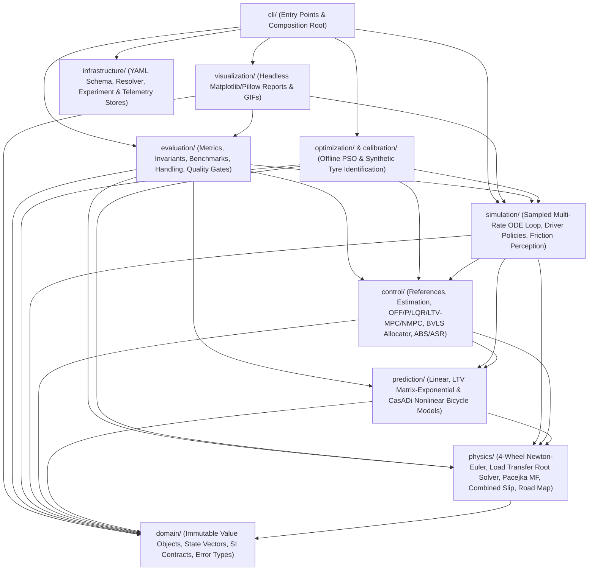

# Software Architecture and Dataflow Specification

This document describes the layered hexagonal package structure, dependency invariants, runtime composition pipeline, and persistence architecture of `torquevector` (`src/torquevector/`).

---

## 1 Layered Package Structure and Acyclic Dependency Graph

The package [`src/torquevector/`](../src/torquevector/) is organized into nine strictly separated domain and infrastructure subpackages. Layer boundaries and zero-cycle invariants are enforced on every test run by [`src/torquevector/evaluation/architecture.py`](../src/torquevector/evaluation/architecture.py), [`tests/architecture/test_dependencies.py`](../tests/architecture/test_dependencies.py), and [`tests/quality/test_q13_software.py`](../tests/quality/test_q13_software.py).

### Architectural Invariants Enforced by Automated Tests
- **Pure Domain Core (`domain/`)**: Contains only frozen dataclasses and mathematical value objects (`VehicleParameters`, `TyreParameters`, `WheelParameters`, `VehicleState`, `TorqueControls`, `ManoeuvreSpec`, `RoadSurface`). It never imports GUI toolkits (`matplotlib`, `PIL`, `tkinter`), `visualization`, `cli`, or `infrastructure`.
- **YAML Isolation (`infrastructure/config/`)**: Raw YAML parsing (`PyYAML`) is restricted exclusively to `infrastructure/` and `cli/`; core mathematical layers (`domain`, `physics`, `prediction`, `control`, `simulation`) accept only strongly typed Python dataclasses (`test_yaml_only_in_infrastructure_and_cli`).
- **Causal Controller Boundary (`control/`)**: Controllers depend only on `EstimatedState`, `ControllerReference`, and `PreviewHorizon` via [`Controller.command()`](../src/torquevector/control/interfaces.py) returning `MomentCommand`. They cannot import plant derivative evaluators (`derivative`, `forces_at`, `simulate_sampled`) or wheel slip $\kappa_i$ (`test_Q11_5_controller_path_uses_torque_only`).

---

## 2 Runtime Composition Root (`src/torquevector/cli/composition.py`)

Configuration resolution and object graph construction follow a deterministic three-stage pipeline:

1. **YAML Resolution and Provenance Tracking (`resolver.py`)**:
   - `resolve()` merges the base application configuration (`configs/default.yaml`), modular component includes (`vehicle`, `tyre`, `wheel`, `road`, `controllers`, `allocation`, `simulation`, `scenario`, `visualization`, `validation`), optional profile overrides (`--profile`), and CLI key-value overrides (`--set path=value`).
   - Every scalar leaf records its exact file and line origin (`origins.json`) and is validated against the typed unit/range schema (`schema.py`).
   - A canonical SHA-256 fingerprint (`resolved.fingerprint`) is computed over the normalized configuration tree.
2. **Typed Object Binding (`composition.py:build_runtime`)**:
   - Maps every resolved schema field explicitly onto immutable runtime dataclasses (`RuntimeConfiguration`), verified for $100\,\%$ bidirectional coverage by [`tests/architecture/test_configuration_bindings.py`](../tests/architecture/test_configuration_bindings.py).
3. **Sampled Closed-Loop Execution and Artifact Persistence (`ExperimentStore`)**:
   - Executes `simulate_sampled()` across each scenario and controller, writing reproducible telemetry CSVs, JSON metrics, configuration snapshots, logs, and optional PDF/PNG/GIF reports into `results/<run_id>/`.
